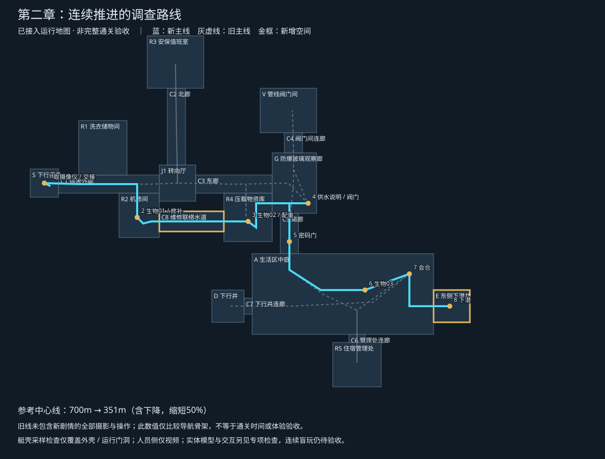

# 第二章动线重排：边调查，边接近会合点

2026-10-27。runtimeProfile `main-authored`，第二章 / -1层 / `legIndex=1`。

状态：IMPLEMENTED（主游戏第二关新动线、剧情事实机、视频任务适配、近场交互与版本化存档）／REQUIRED（持续视觉、连续游玩与资源验收）／GAP（正常真实生成影片全链、连续盲玩通关、商业级视觉质量）。第一章继续使用 `harbor-simple-flow.ts`，不得接入本章尸体摄像仪调查流程。此状态覆盖下文原设计阶段的预期；逐项实作证据见 `level-02-survey-production-2026-10-27.md`。

## 核心改法

玩家的目标始终在前方：入口取摄像仪并交接 → 机修间第一只生物 → 压载库第二只生物 → 观察廊处理供水 → 南廊密码门 → 中庭第三只生物 → 闸门会合 → 邻近下潜井。

需要的东西在发生问题之前或当场出现。第一只生物所在的机修间同时提供修补材料；第二只生物所在的压载库同时提供下潜配重；收到面罩污染求助时，玩家即将抵达供水检修站；门锁就在检修站之后。关闭供水后原地通知艾里亚斯，等待他的结果回片，不再驾驶返回某个通信点。

保留可撤退、可探索的旧道路，但不再让支路钥匙控制主线。R1洗衣房、R3安保室、V阀门间、R5管理处可选；不去这些房间仍能完成三份调查、救助、会合与下潜。旧密码纸条不再用于新主线，避免它与每局随机密码冲突。

## 节点和玩家经历

坐标为世界 `(X,Y,Z)`，Y是高度；界面深度为1040−Y。下表是空间锚点，不能直接当作已经验收的机械臂抓取位。

| 顺序 | 区域、位置 | 玩家实际完成什么 | 如何结束这一段 |
|---|---|---|---|
| 1 | S，井底 `(7,0,7)` | 新开局直接停靠井底，可看到尸体和旁边仪器匣。搜取移动水下摄像仪，通过通话窗口交接；未取时艾里亚斯提醒。 | 匣子取回、交接确认、任务录像核验后，分别行动。艇载原有摄影系统不凭空消失。 |
| 2 | C1→R2，机修间 `(53,0,24)` | 被动声源先暴露第一只生物；玩家选择停靠位，开灯摄影并确认公司收件。侧边同一作业区放修补材料。 | 可以修补再出发，也可承担风险继续。东门是下一段出口，不原路退回C1。 |
| 3 | C8→R4，压载库 `(108,0,26)` | 第二只生物采用与第一只不同的趋光/避光反应。配重与补给放在通过路线旁。 | 两份不同目标的有效影像已收到，触发艾里亚斯被污染的必需视频；从R4东门进入G。 |
| 4 | G，供水检修站，工作区 `(128.5,0,17)` 至 `(137.8,0,17)` | 任意有效文字回复求助后，他说明含硫温水线索。玩家开灯拍说明牌、看片辨认，再操作对应阀门；原地告知艾里亚斯，核验菌群消散视频。 | 说明牌、阀门组在同一个作业面。错阀反馈发生在此处，可就地纠正；不另发地图另一端的补救任务。 |
| 5 | C5南廊，门前 `(128.5,0,36)` | 接近第三处时发现锁门，向艾里亚斯求助。他从人员侧终端取得本局密码并回传视频。 | 在门旁输入，错误可重输。录像重试沿用同一密码。现场开锁后进入中庭。 |
| 6 | A，中庭中东段 `(166,0,60)` | 第三只生物用声源位置和空间遮挡形成摄影选择，不再复制前两次消耗。 | 取得第三份有效影像，公司开放后续权限。公司收件不等于艾里亚斯已安全到达。 |
| 7 | A-N，原F闸门外 `(188,0,52)` | 艾里亚斯完成自己的第四处调查，两条路线在本章末汇合。 | 已完成消散核验、密码门和三份影像，才允许会合结果成立；保留头盔，第三章前不揭示异常。 |
| 8 | E，新东侧下潜井 `(208,0,68)` | 会合点向前约36m抵达井中，完成下潜。 | 检查配重、会合与公司权限。艾里亚斯之后的人员通路须在转场说明，不默认登艇。 |

第一只与第二只的伤害目标是让修补成为有价值的选择；不安排无条件扣血，不要求玩家故意被撞才能推进。优先采用已有原生盲猎者与避光鳗，不能把Panacea共生介质改成攻击怪物。第三只不追加一段必定耗损，避免把结尾做成资源软锁。

前两份影像的收件顺序允许互换，但帮助事件只触发一次；新动线自然引导01→02，不把序号顺序写成多余门槛。提前拍到说明牌可保存事实，仍须听到求助、回复并关闭正确支路。阀门先关闭后再通知、反复通知、延迟通知，都由物理事实决定回复，不重复发奖或重新开管。供水消息与密码消息可在当前位置处理；只有实际取物、关阀和输入门码需要对应物理位置。

## 地图施工范围

1. **入口设备移到S井底**。尸体仪器匣与交接设施在同一停靠区。机械臂只夹取匣子，不搬尸体。通话窗口承担交接操作入口；不得仅用一句“已传递”冒充尚不存在的实物/库存转移。设备箱、短传递口与人员侧抵达关系需要实际制作。旧R3探头箱不能重复授予任务设备。
2. **R2东侧新增联络水道C8**：X64—96、Z21—31、地板−3、顶3。两端门洞X64/X96、Z22—30，净宽8m、净高5.5m。R2与R4不再是主线死胡同。
3. **R4东墙开至G的门**：X120、Z13—21，净宽8m、净高5.5m。进入G后沿作业面操作，再驶向南廊。开门还需同步GLB墙面、装饰与摄影遮挡，不只删碰撞盒。
4. **G增加供水说明与操作组**：优先复用既有东侧管道作业区。说明牌与各阀门共用一个安全作业面，适度调整艇位即可完成，阀门仍用已有近距终端操作，不凭空增加机械臂拧阀能力。原V的主管线保留可选调查；不再让玩家去那里寻找唯一解。
5. **C5-A设置真正的密码隔离门**：使用现有8.4m开口，门前保留完整艇体停靠与回撤空间。关门时驾驶、声纳与摄影同样被阻挡；开门后只移除门叶对应阻挡。不得只在任务文字里说“门锁住”。
6. **中庭东侧新增E下潜井**：X200—218、Z60—76，地板−60、顶3；A-E门X200、Z64—72。原西侧D不再作为新流程出口。旧存档须保留原出口语义或明确迁移，不能让恢复中的玩家莫名换目标。

仅增加一段32m联络水道和一座邻近出口井；复用主要房间与主体资产。美术摆设全部遵守 `decorColliders`，新增结构、门和任务设备才进入结构通道。

## 跑图量：先测距离，不许靠提速掩盖布局

`npx tsx tools/living-route-proposal.ts` 输出图和 `qa/living-route-2026-10-27/geometry.json`。旧线固定使用旧出生高度30m及 `LIVING_MAIN_ROUTE`；新线直接读取运行时 `LIVING_SURVEY_ROUTE`，包含入口操作位微调及出口下降40m，取消入口30m空白下降。工具不再向运行时数组重复追加已建成房间。

| 比较口径 | 现有参考线 | 新方案参考线 | 差异 |
|---|---:|---:|---:|
| 含上下潜的导航骨架 | 700.1m | 350.5m | 减少49.9% |
| 水平导航骨架 | 630.0m | 310.5m | 减少50.7% |

主要取消的是R3北廊折返、V供水支路折返、R5密码支路折返和会合后向西横穿中庭。G保留约9m工作面接近/离开，不为消灭所有局部倒车而强行造一条巨大环路。

这不是等内容实测：旧参考线未包含新增三只生物任务的完整拍摄、操作位微调，新线也未计追逐、误路和玩家探索。只能说导航骨架明显缩短，不能宣称通关时间缩短46.6%。各节点机位及机械臂接近路径须计入后续完整路线。

检查结果：2.8×5×3m艇壳，位移采样0.1m，转向采样0.5°，共6379次检查，无运行外壳/门洞碰撞。只覆盖静态外壳，没有覆盖最终GLB、物资箱、门叶、生物、摄影和操作射线；不等于实机可玩验收。

## 剧情接入契约

主链事实依次为：`cameraCollected → cameraTransferred → assignmentViewed → photo01Accepted + photo02Accepted → helpViewed → playerReplied → manualRead → sulfurClosed → closureReported → clearViewed → doorInspected → codeRequested → codeViewed → doorUnlocked → photo03Accepted → companyAccess → reunionVerified → descended`。

这些契约已由 `living-survey.ts` 与 `living-deck-site.ts` 接入；真实生成影片全链尚未验收。摄影采集、分析核验、公司收件分开记录；重复提交同一只生物不能凑数。手动自由拍照不由任务阶段锁死，任务推进另验帧中目标、照明、遮挡和真实回片。公司是否灭口只是艾里亚斯的推测，不能由系统旁白确认为事实。

自由输入保留情绪和策略差异：怕、催促、辱骂、安慰、怀疑公司、询问死者、要求撤退。任何非空回复都能接住求助；辱骂不永久锁主线；口头谎报关阀不改变阀门事实；核验完毕后的道歉影响后续口气。将“愿意修补再走 / 冒险不修”“先断主动声纳 / 保持通电侦测”“探索支路 / 直接推进”的后果落到资源、危险或额外证据上，不能只换一句台词。

每局密码在该局初始化一次，进入视频提示词与存档。生成失败、重试、读档不会换码。门口可重新播放密码回片；玩家不能靠在通信窗说“门开了”越过门禁。网络失败允许重试，不将待生成/占位视频标成已核验。原调试无视频例外若扩展到第二章，须显式区分诊断证据，不能污染正常存档。

## 原设计阶段MET复核（历史基线）

下表保留设计时缺口，当前逐项状态以 `level-02-survey-production-2026-10-27.md` 为准，不把旧缺口静默改成已验收。

| MET | 本方案处理与剩余缺口 |
|---|---|
| 001 | 主游戏第二关；第一关不动。运行接线未完成。 |
| 002 | 2.8×5×3外壳采样通过；主体资产未验。 |
| 003 | 新门8m、主通道10m；最终门框净空待验。 |
| 004 | 不改驾驶速度；距离有记录，无时间承诺。 |
| 005 | 摄影位和近距操作位分别验收，当前仅路线锚点。 |
| 006 | 完整摄影视场/遮挡未验，G说明牌需实拍。 |
| 007 | 说明牌开灯摄影才能辨认；字号曝光待实机验。 |
| 008 | 雷达不直接提供身份或公司证据。 |
| 009 | 沿用曝光与机械臂互斥，不边抓边拍。 |
| 010 | 沿用串行摄影与生成重试，不把等待换成跑腿。 |
| 011 | 采集、核验、收件、NPC知道的事实分别保存。 |
| 012 | 三次生物摄影、说明书及结果回片；完整循环配额仍待实机复核。 |
| 013 | 安全作业面承接看片和沟通；威胁不因读片自动暂停。 |
| 014 | 机械臂只夹箱；入口箱与材料操作时序待验。 |
| 015 | 密码开锁、真实门叶开放、会合分别判定。 |
| 016 | 前两次不同应对，第三次不同空间；追逐和无伤策略未验。 |
| 017 | 沿途维修与配重；完整电量/耗损预算仍GAP。 |
| 018 | 删除四段强制折返；路线工具已量化，不声称时长达标。 |
| 019 | 移动摄像仪不抹掉首关艇载相机，交接机制待实现。 |
| 020 | 新开局艾里亚斯线；旧伤亡/拒绝分支保存不能硬改成健康。 |
| 021 | 新出口需版本化存档、密码持久化与安全位置复核。 |
| 022 | 设计、几何结果和未验项目分别登记。 |
| 023 | 不把旧原型语句当新机制完成；不冒称真实录像已出片。 |
| 024 | 模型只写回应，不能授予物理事件或公司权限。 |
| 025 | 两次资源压力→合作判断→门前等待→空间调查→会合。 |
| 026 | 供水串线和公司调查授权进入主线，支路补事故材料。 |
| 027 | 装备/灯/声纳/支路影响资源危险证据，台词变化不代替结果。 |
| 028 | 复用三种已有物资与主要房间；新增连接段和出口井有明确成本。 |
| 029 | 门、阀门、箱子必须绑定实际目标和位置；目前交接/新操作面未实现。 |
| 030 | 被动方位→选机位→等待→看片→关阀→对侧结果→门控。 |
| 031 | 本表逐项列缺口；无AAA、恐怖或60分钟认证。 |
| 032 | 本文为制作方案，不向小说正文插状态表。 |
| 033 | 沿用前章已认识的艾里亚斯；入口下降与分路过程保留。 |
| 034 | 供水铭牌、受控生物和门禁交叉核对；推测不变事实。 |
| 035 | Panacea不攻击；污染菌独立；不提前揭露头盔。 |
| 036 | 台词给下一个节点的理由和坐标，不一次倾倒全图。 |
| 037 | 无视频诊断扩展须标记，正常模式真实核验不省略。 |
| 038 | 不用新任务擅改调频和接收范围。 |
| 039 | 沿用现有设备与坐标输入，不新增绕路用专门键盘。 |
| 040 | 首关仅救援管线，误放调查原型继续归档。 |
| 041 | 本文覆盖旧第二关强制北廊、阀门间、办公室往返；接线未完成。 |
| 042 | 外壳/门/任务物属结构；装饰独立且视觉避让主通路。 |
| 043 | 结尾承接第三关；人员转场说明和旧存档跨关回归待补。 |

实际接入顺序：先新增通路、供水工作面、密码门和出口井并验真实艇体路径；再迁移尸体设备和主线状态机；随后接任务视频、自由输入、资源遭遇及存档；最后测试第一章不串任务、第二章所有门槛可恢复、第三章衔接。不得把本次独立外壳检查结果用作上述工作的完成证明。
